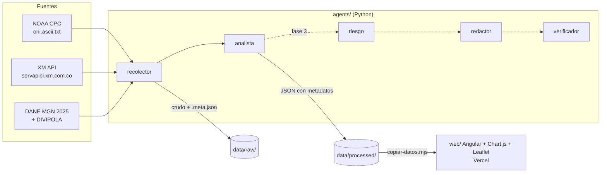

# Observatorio agéntico de El Niño 2026–2027 🇨🇴

Sistema multiagente que cada semana recoge datos sobre El Niño en Colombia, cruza clima con
impactos y publica un boletín y un dashboard web.

> **Estado:** fase 2 — dashboard Angular con gráficas del ONI y embalses y mapa de Colombia.

## Arquitectura



| Agente | Qué hace | Salida |
|---|---|---|
| `recolector` | Descarga los datos tal como llegan y anota fuente, URL y fecha de descarga | `data/raw/` (no se versiona) |
| `analista` | Limpia, calcula indicadores y compara con El Niño 2015–16 y 2023–24 | `data/processed/*.json` |

En la fase 1 los agentes son **Python determinista** (sin LLM): descargar y promediar no
necesita un modelo, y así los resultados son reproducibles y gratis. Los agentes con LLM
llegan en la fase 3 (redactor y verificador).

## Fuentes (verificadas el 2026-11-04)

| Fuente | URL | Notas |
|---|---|---|
| NOAA CPC — ONI | `https://www.cpc.ncep.noaa.gov/data/indices/oni.ascii.txt` | Texto plano `SEAS YR TOTAL ANOM`. Se descarga completo cada vez (NOAA revisa el histórico). |
| XM — embalses | `POST https://servapibi.xm.com.co/daily` | Máx. 31 días por consulta; % llega como fracción (0.77 = 77 %); valor a veces como texto. Métricas: `PorcVoluUtilDiar`, `VoluUtilDiarEner`, `CapaUtilDiarEner`, `ListadoEmbalses`. |
| DANE — límites | FeatureServer MGN 2025, capa 319 | El MapServer devuelve geometría nula; `where=1=1` es bloqueado; los nombres llegan con tildes dañadas, por eso se toman de DIVIPOLA (datos.gov.co `gdxc-w37w`) uniendo por código DANE. |

## Datos generados

- **`data/processed/oni.json`** — serie desde 1950 con fase de cada trimestre, eventos
  detectados (regla NOAA: ±0.5 °C durante 5 trimestres) y comparación con 1997–98,
  2015–16 y 2023–24.
- **`data/processed/embalses.json`** — % útil diario del sistema desde 2015 (cifra oficial
  XM), % por región hidrológica ponderado por capacidad, temporadas El Niño alineadas
  desde el 1 de julio y un bloque `control_calidad`.

Cada archivo trae un bloque `metadatos` con fuente, URL y fecha de descarga.

## Cómo correrlo (Windows / PowerShell)

```powershell
python -m venv .venv
.\.venv\Scripts\Activate.ps1
pip install -r requirements.txt

python -m agents.pipeline                 # descarga + análisis (1.ª vez ~1–2 min)
python -m agents.pipeline --sin-descarga  # solo re-analiza lo ya descargado

pytest          # pruebas (no usan internet)
ruff check .    # estilo

# Sitio web (requiere Node.js >= 22)
cd web
npm install
npm start       # http://localhost:4200
```

## Despliegue

Vercel importa el repositorio desde la raíz; `vercel.json` le indica instalar y compilar
dentro de `web/` y publicar `web/dist/web/browser`. Cada push a `main` redespliega.

En macOS/Linux, activa el entorno con `source .venv/bin/activate`.

## Secretos

La fase 1 no necesita claves. Para fases siguientes, copia `.env.example` como `.env` y
rellénalo. `.env` está en `.gitignore`: **nunca** se sube al repositorio.

## Fases

1. ✅ Esqueleto + `recolector` y `analista` (ONI y embalses) → JSON en `data/`.
2. 🚧 App Angular con gráficas y mapa (hecha); deploy en Vercel (pendiente).
3. Agentes `riesgo`, `redactor` y `verificador`; boletín semanal; GitHub Actions.
4. Chat sobre los datos (ruta serverless en Vercel).
